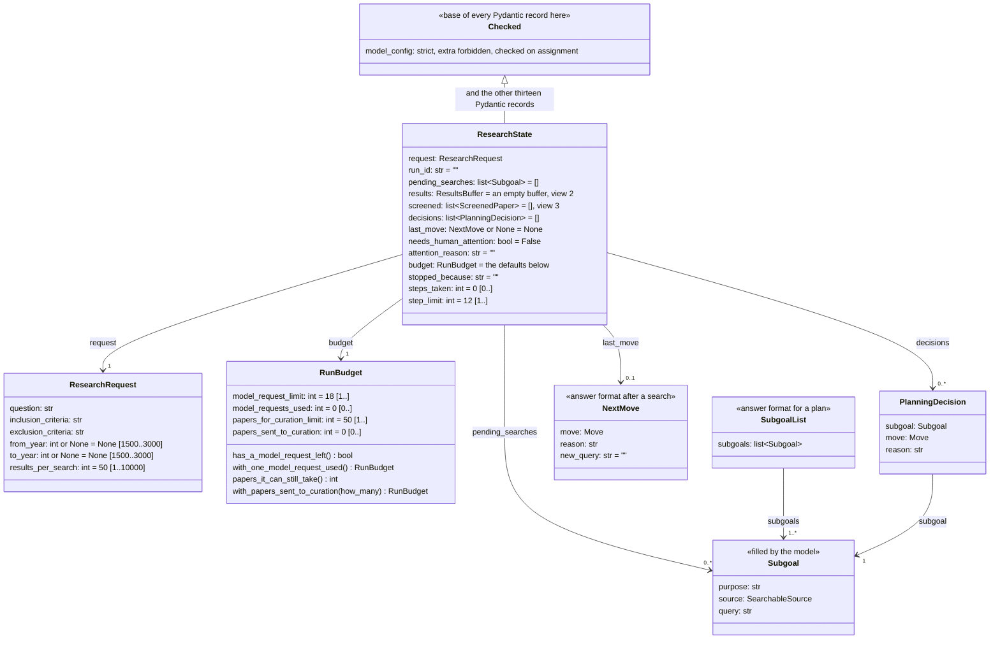
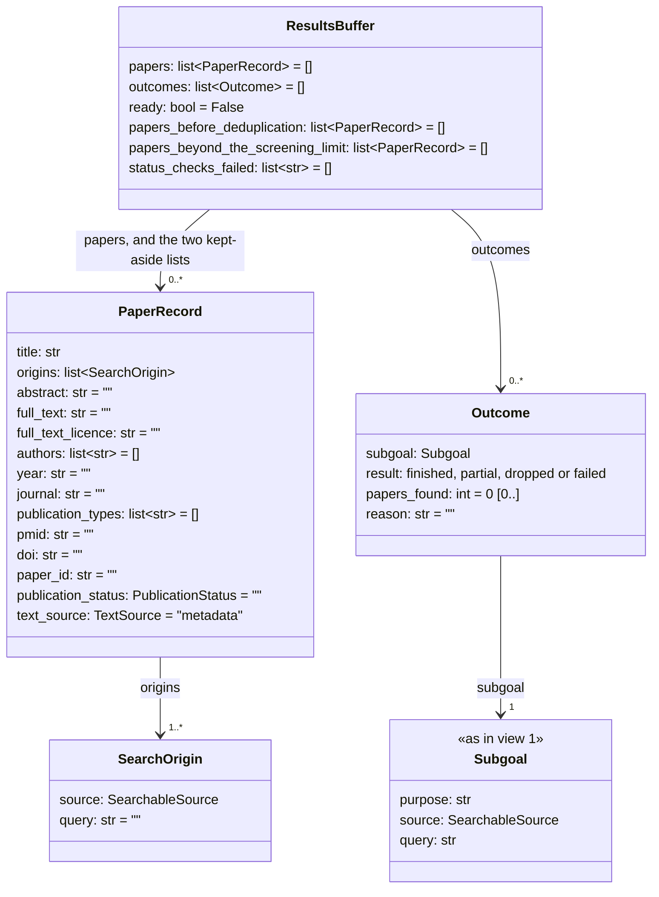
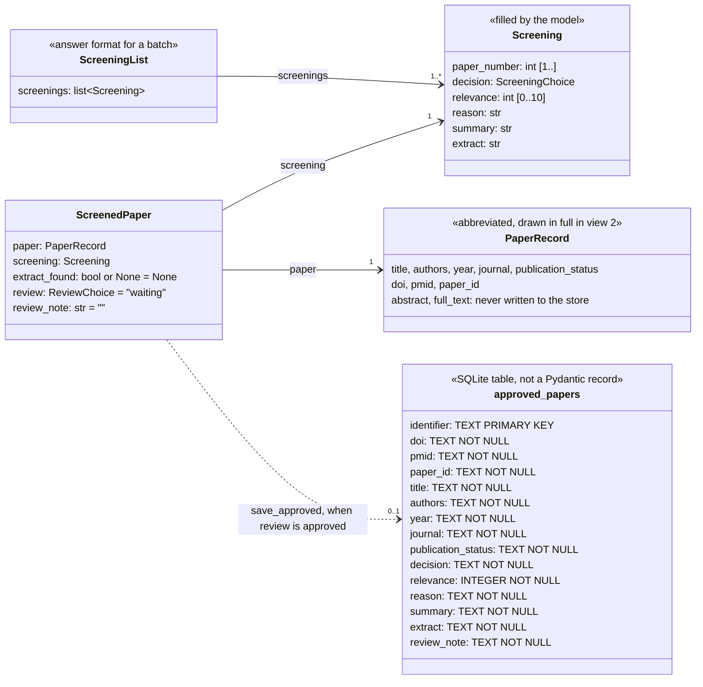

# Class diagram: records and stored data

The three views cover the main data entities, their properties and their relationship to the Pydantic models and SQLite table (TF-01).

Records extend `Checked`. Solid arrows show fields holding records. Labels give multiplicity. The inheritance arrow represents the common base. The dotted arrow in view 3 shows conditional storage. It does not show ownership. `list~X~` means `list[X]`. A default follows `=`. A record may be valid when built and later changed, so the graph revalidates the whole record at handover and completion.

## View 1: The request, plan and run

## View 2: Retrieved papers and search outcomes

## View 3: Judgement, human decision and SQLite row

## Storage and scope

A judgement is paired with its paper by batch number. Response order is not used. The curator checks that every requested paper is judged exactly once. Storage accepts only approved, identified records whose extract passes its checks. One refusal stops the batch. The paper's abstract and full text are not stored. Repeated approval updates a row, and a withdrawn decision removes it.

These views omit service reply formats and the records used to read stored results and prepare reports. Fixed values and detailed validators are defined in `research_agent/schemas.py`. SQLite columns and identifier rules are in `research_agent/processing/storage.py`. The record keeps a full-text field, which no implemented run fills.

## Verification

The diagrams were read against the code they describe and rendered at the size
they are published in.
