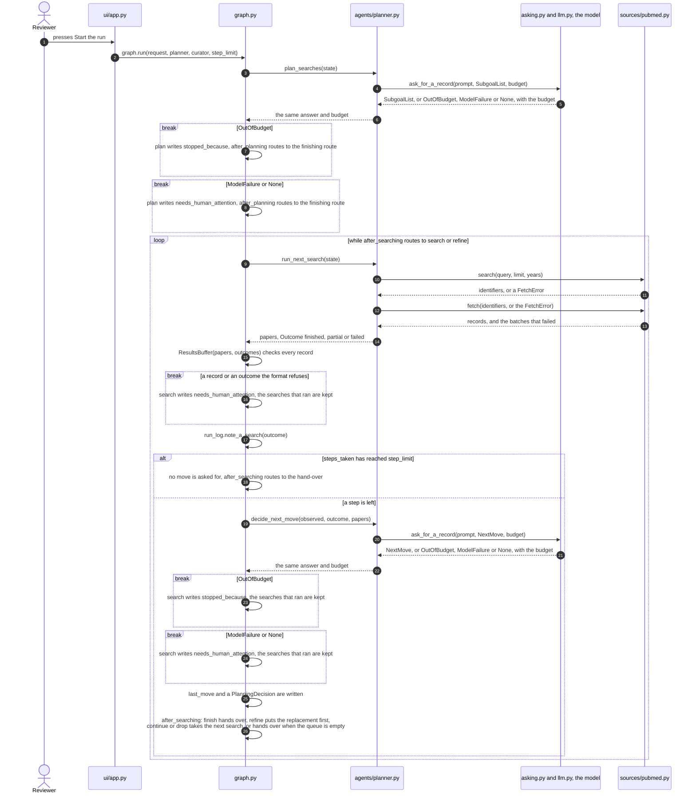
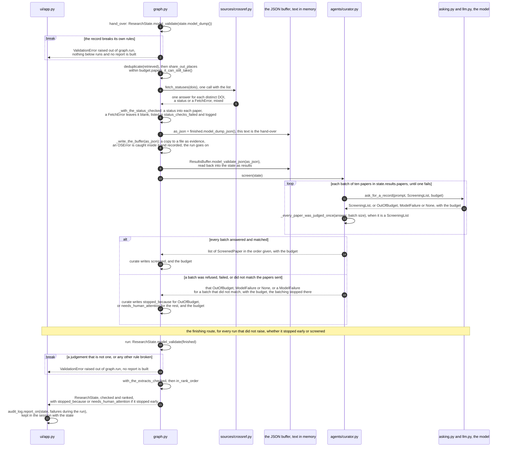
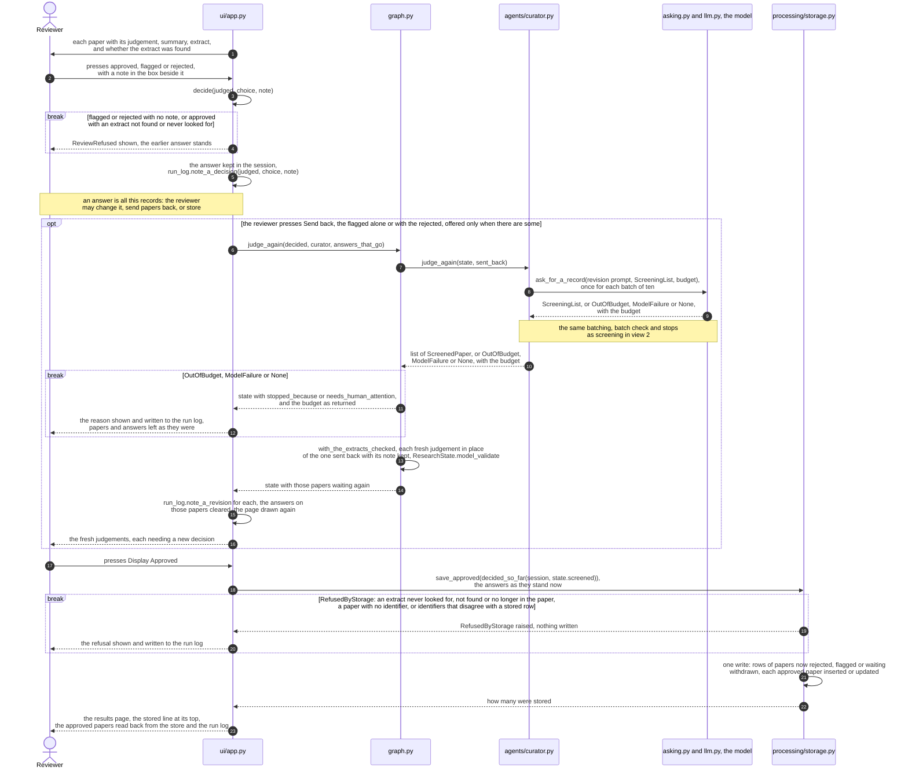

# Sequence diagram: planning, handover and human review

The three views show agent interactions and error handling (TF-02).

Solid arrows are calls or human actions. Dotted arrows are returns or raised errors. `alt`, `loop` and `break` show branches, repetition and stops. The model lane combines the bounded repair helper and Gemini adapter. The JSON buffer is serialised and validated between graph steps. PubMed illustrates retrieval. Semantic Scholar follows the same planner boundary. Crossref checks publication status. It does not search for papers.

## View 1: Planning and searching

## View 2: Hand over, screening and completion

## View 3: Reviewer decisions, revision and storage

## Error paths and verification

| Path | Behaviour and evidence |
|---|---|
| Source unavailable | Bounded HTTP retries return a failure. The planner records failed/partial coverage. UT-02/UT-22 and FT-04 |
| Unreadable or wrong shape service reply | Source failure reported. Invalid shared records are refused at graph boundaries and shown/logged by the screen. UT-07, IT-03 |
| Invalid plan | Initial request plus at most three schema repairs, within the run budget. Unresolved failure asks for human attention. UT-06 and FT-05 |
| Budget exhausted | Refusal before spending the next request. Reason carried to the screen. UT-25, IT-05/IT-08 |
| Human flag/rejection | Notes accompany selected papers on revision. Fresh judgements need new decisions. IT-08 and FT-09 |

The integration tests differ in what they replace. Graph tests may use replacement agents. Planner tests in the graph keep the agents and replace model and source calls. AppTest exercises the screen. Storage tests use a temporary database. Passing one does not verify the whole workflow against live services.

The diagram was read against the code it describes and rendered at the size it
is published in.
